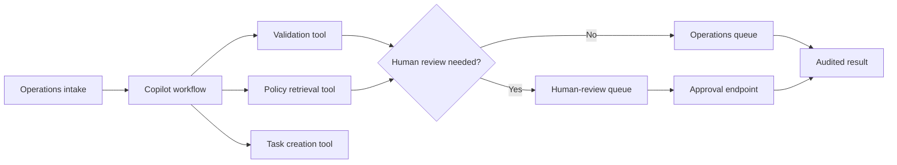

# Healthcare Operations Copilot

An auditable agent workflow that turns synthetic healthcare operations requests into policy-grounded tasks while routing incomplete or urgent requests to a human reviewer.

> **Portfolio and educational use only.** The sample data is synthetic. This project does not provide medical advice and must not be used for diagnosis, treatment, emergency decisions, or production handling of protected health information.

## Why this project matters

Healthcare operations teams receive referrals, prior-authorization requests, scheduling requests, and records requests through fragmented channels. This project demonstrates how an AI-style workflow can standardize intake without hiding decisions behind a black box.

The copilot:

- validates each intake against operational requirements;
- retrieves the relevant local policy and returns citations;
- creates work-queue tasks through an explicit tool layer;
- requires human approval for urgent or incomplete requests;
- records a tool trace and immutable-style audit events;
- exposes the workflow through a FastAPI service.

## Architecture



The workflow is deterministic by default. That design makes it easy to test, evaluate, and explain. An LLM-backed planner can later be added behind the same tool interfaces without changing the safety gates.

## Repository layout

```text
app/
  main.py        FastAPI endpoints
  models.py      Typed request and response contracts
  workflow.py    Agent orchestration and review gate
  tools.py       Explicit tool registry and operations tools
  policies.py    Local policy retrieval
  store.py       Thread-safe demo result store
data/
  policies.json
  evaluation_cases.json
scripts/
  run_evaluation.py
tests/
```

## Run locally

1. Create and activate a virtual environment.

   ```bash
   python3 -m venv .venv
   source .venv/bin/activate
   ```

2. Install the development dependencies.

   ```bash
   python -m pip install -r requirements-dev.txt
   ```

3. Run quality checks and tests.

   ```bash
   ruff check .
   pytest --cov=app --cov-report=term-missing
   python -m scripts.run_evaluation
   ```

4. Start the API.

   ```bash
   uvicorn app.main:app --reload
   ```

5. Open the interactive API documentation at `http://127.0.0.1:8000/docs`.

## Example request

```bash
curl -X POST http://127.0.0.1:8000/v1/intakes/analyze \
  -H 'Content-Type: application/json' \
  -d '{
    "request_id": "DEMO-001",
    "request_type": "prior_authorization",
    "submitted_urgency": "soon",
    "requested_service": "Synthetic imaging request",
    "referring_department": "Orthopedics",
    "insurance_plan": "Synthetic PPO",
    "consent_confirmed": true,
    "attachments": ["synthetic-order.pdf"]
  }'
```

The response includes the workflow status, generated tasks, policy citations, tool trace, audit trail, and safety disclaimer.

## API endpoints

| Method | Endpoint | Purpose |
|---|---|---|
| `GET` | `/health` | Service health check |
| `POST` | `/v1/intakes/analyze` | Analyze and route an operations intake |
| `GET` | `/v1/intakes/{request_id}` | Retrieve a prior result |
| `POST` | `/v1/intakes/{request_id}/approve` | Record human approval |

## Evaluation strategy

`scripts/run_evaluation.py` runs labeled synthetic cases and checks both the workflow status and destination queue. The unit tests also cover policy citations, tool order, review triggers, persistence, and approval.

Useful next steps:

- add a PostgreSQL repository with append-only audit storage;
- add authentication and role-based access controls;
- connect a real policy index with versioned citations;
- add an optional LLM planner and prompt-injection tests;
- add OpenTelemetry traces and latency/cost dashboards;
- complete security, privacy, legal, and clinical governance reviews before any real-world use.

## Design decisions

- **Human-in-the-loop:** urgent and incomplete requests cannot silently proceed.
- **Policy grounding:** every supported request type returns a policy citation.
- **Inspectable tools:** the orchestrator calls named tools and returns their trace.
- **Synthetic data only:** examples intentionally avoid real patient information.
- **Framework-independent core:** orchestration logic is separate from the API layer.

